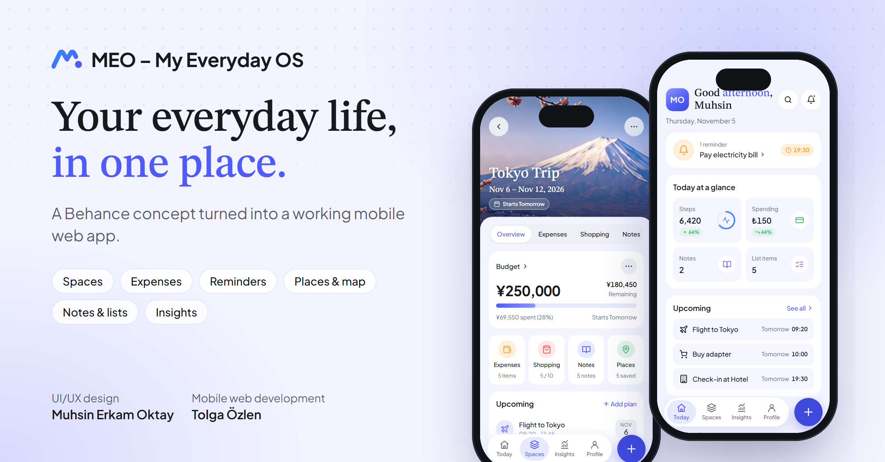

# MEO – My Everyday OS

**Your everyday life, in one place.** MEO brings notes, reminders, expenses, shopping lists and saved places together in *Spaces*: a trip, a fitness routine, a work project or everyday life.

This repository is a working mobile web app built from the [MEO concept on Behance](https://www.behance.net/gallery/257594625/MEO-My-Everyday-OS-Personal-Life-OS-Mobile-App) by Muhsin Erkam Oktay.

**Live demo:** https://vagobandoras.github.io/meo-everyday-os/ (best on a phone; on desktop it opens in a phone frame)



## Features

- **Today:** greeting, today's reminders, steps and spending at a glance, upcoming plans, a daily insight
- **Spaces:** cover photos, budget tracking, modules (expenses, shopping, notes, places, reminders, goals, flights, hotel, contacts) and recent activity
- **Guided flows:** create a Space (3 steps), add an expense, add a reminder (4 steps with calendar and repeat), add a place (3 steps)
- **Places:** map with pins, distances and directions links
- **Notes:** checklists and related places and Spaces
- **Search:** results grouped by type across everything you saved
- **Insights:** 7-day spending chart, top categories, smart insights
- **Profile:** default currency, light/dark/system theme, backup and restore

## How it works

- Plain HTML, CSS and JavaScript, with no framework and no build step
- Data is stored in the browser's `localStorage`. Nothing is sent to a server.
- The app opens with sample data (a Tokyo trip, expenses, notes). Profile → Backup & Sync → *Reset to sample data* restores it.
- Currency conversion uses fixed sample rates (1 JPY = ₺0.23, 1 USD = ₺41, 1 EUR = ₺48).
- Step counts are sample data. A native app would read them from Apple Health or Health Connect.

## Run locally

Open `index.html` through any static server, for example:

```bash
python -m http.server 8000
```

Then visit http://localhost:8000.

## Credits

- **UI/UX design:** [Muhsin Erkam Oktay](https://www.behance.net/gallery/257594625/MEO-My-Everyday-OS-Personal-Life-OS-Mobile-App)
- **Mobile web development:** Tolga Özlen

The design, the MEO name and the photos in `img/` belong to the designer and are used with his permission. They are not licensed for reuse.

---

### Türkçe

MEO; notları, hatırlatıcıları, harcamaları, alışveriş listelerini ve kaydedilen yerleri "Space"ler içinde bir araya getiren kişisel bir yaşam uygulaması. Bu repo, Muhsin Erkam Oktay'ın Behance'teki MEO konseptinin, tasarımcının izniyle geliştirilmiş, çalışan mobil web sürümüdür. Canlı demo: https://vagobandoras.github.io/meo-everyday-os/
